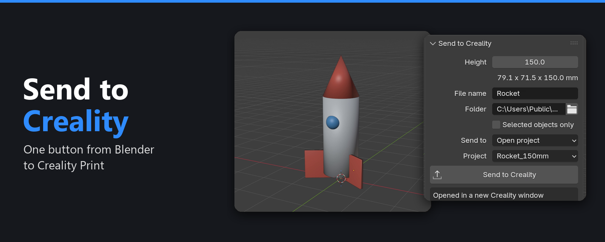
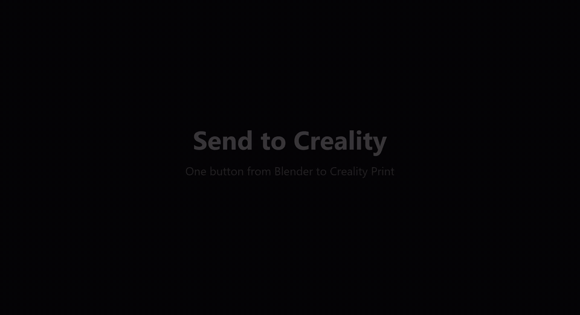
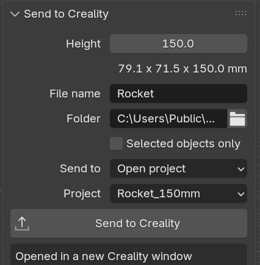

<div align="center">



# Send to Creality

**Send a model from Blender to Creality Print with one button.**

The add-on merges your parts into one printable solid, sets the height, checks the mesh and delivers it to the Creality project you choose.


[Demo](#demo) · [Install](#install) · [How to use it](#how-to-use-it) · [How it works](#how-it-works) · [Troubleshooting](#troubleshooting)

</div>

---

## Demo

Installing the add-on, then sending a model to Creality Print:

<div align="center">
<a href="https://github.com/RAKIZA-STUDIO/blender-send-to-creality/releases/download/v1.1.0/send_to_creality_demo.mp4">

</a>

[Download the full video (MP4, 58 seconds)](https://github.com/RAKIZA-STUDIO/blender-send-to-creality/releases/download/v1.1.0/send_to_creality_demo.mp4)
</div>

---

## Why use it

Going from Blender to a slicer usually means merging parts, fixing the scale, exporting and importing by hand, then doing it all again after every change. This add-on does those steps in one click and leaves your Blender objects untouched.

## Features

| | |
|---|---|
| **One printable solid** | Merges copies of your parts, so text and other overlapping parts join cleanly |
| **Exact height** | Set the printed height in millimeters and see X, Y and Z update as you type |
| **Print-ready position** | The bottom of the model sits at Z = 0, centered on the origin |
| **Choose the destination** | Add to an open project, open a new window, or just save the file |
| **Pick the project** | With several Creality windows open, choose which one receives the model |
| **Safety checks** | Refuses open surfaces and warns about separate floating pieces |
| **Non-destructive** | Works on copies, so your scene stays exactly as it was |

## Install

1. Download `send_to_creality-1.1.0.zip` from the [latest release](../../releases/latest). Don't unzip it.
2. In Blender, go to **Edit > Preferences > Add-ons**.
3. Click the down arrow at the top right and choose **Install from Disk**.
4. Select the zip file and make sure **Send to Creality** is ticked.

## How to use it

Press `N` in the 3D viewport and open the **Print** tab:

<div align="center">

</div>

1. Set the **Height**.
2. Type a **File name**, or leave it empty to use the Blender file's name.
3. Choose **Send to**, and pick the **Project** if you're adding to an open one.
4. Click **Send to Creality**.

### Where the model goes

| Send to | What happens |
|---|---|
| **Open project** | Adds the model to the open Creality project you pick. If none is open, Creality starts with the file. |
| **New window** | Opens the model in its own Creality window. |
| **File only** | Saves the STL without opening Creality. |

STL files are saved to `Documents\Blender Prints` by default, and the file path is copied to your clipboard. Sending again with the same name and height overwrites that file.

> [!NOTE]
> Each send adds a new copy to an open project and does not replace the old one. Delete the old copy first, and slice again after each change.

> [!TIP]
> The add-on uses everything visible in the scene. Hide an object to leave it out, or tick **Selected objects only**.

## How it works

1. **Collect** the visible objects, with their modifiers applied.
2. **Split** them into connected parts, so overlapping letters can't leave stray faces inside the solid.
3. **Check** that every part is a closed solid.
4. **Merge** the parts one at a time with Blender's Manifold boolean solver.
5. **Verify** that nothing was lost and the result has no mesh errors.
6. **Scale** to your height, then **export** a binary STL.
7. **Deliver** it to Creality Print.

If a check fails, no file is exported and the panel tells you why.

## Requirements

- Windows
- Blender 4.5 or newer (developed on 5.2)
- Creality Print 7 (tested on 7.3.1)

To use a custom install location, set the program path in the add-on's preferences.

## Troubleshooting

| Message | What to do |
|---|---|
| `"Object" is not a closed solid` | That object has holes or is a flat surface. Close it, give it thickness, or hide it. |
| `Merging lost part of the model` | Check the parts for damaged geometry, or send them one at a time with **Selected objects only**. |
| `Warning: separate pieces` | Some parts don't touch. They will print as separate pieces, so move them together if that isn't what you want. |
| `That project was closed, pick another` | The file was saved. Choose another project from the list and send again. |
| `Creality Print was not found` | Set the program path in the add-on's preferences. |

> [!NOTE]
> Adding to an open project uses the same internal message Creality sends when you open a second file. It isn't a documented Creality feature, so a future Creality update could change it. If that happens, the STL is still saved and you can import it by hand.

## Building the zip

```bash
cd send_to_creality && zip ../send_to_creality-1.1.0.zip __init__.py blender_manifest.toml
```

## License

[GPL-3.0-or-later](LICENSE)
